# 🌐 [mirconegri.com](https://mirconegri.com) `v4.0`

[](https://www.typescriptlang.org/)
[](https://vitejs.dev/)
[](https://react.dev/)
[](https://threejs.org/)
[](https://gsap.com/)
[](https://pages.cloudflare.com/)
[](LICENSE)

Personal website and portfolio of **Mirco Negri** — Computer Science student at the University of Trento.

Direct, pragmatic, and built by hand: software built from concrete problems, volunteer service, and wanting to understand how systems actually work under the hood.

---

## Architecture

Unlike monolithic single-page applications, **v4.0** is architected around **Progressive Enhancement & Adaptive Dual-Tier Platform Architecture**:

- **Static HTML First**: Semantic HTML5 document containing all text and structure. Fast first paint, SEO-ready, and fully legible even if JavaScript is disabled.
- **Adaptive Platform Tiers**:
  - **Desktop Profile**: Three.js 3D Strata sphere with 26,000 particles, interactive 3D Solar System with GitHub core and 15 orbiting planets, Lenis smooth inertial scrolling, and GSAP ScrollTrigger reveals.
  - **Mobile Profile**: Zero scroll delay (instant 100% text visibility), GPU-accelerated horizontal touch swipeable carousel with CSS scroll snap at 120 FPS, and 0% background WebGL battery drain.
- **Selective React Islands (`data-island`)**: React 19 is isolated strictly to interactive micro-components ([React Bits](https://reactbits.dev/)) such as kinetic rotating titles, numerical stat counters, spring magnetic buttons, and spotlight gradient cards.
- **Custom Three.js & GLSL Shaders**:
  - **Organic Noise Sphere & Particle Swarm**: An organic sphere dynamically distorted via 3D Simplex noise and GSAP, surrounded by an orbital Fibonacci cloud of 26,000 particles and textured ambient film-grain noise.
  - **3D Projects Solar System**: An interactive celestial solar system with a prominent central GitHub logo core, surrounded by all 15 projects orbiting as custom 3D planetary bodies with rings, moons, and geodesic facets.
- **Canvas 2D Journey Map**: Interactive geospatial map drawing Natural Earth 50m vector coastlines with custom projected path arcs and responsive tooltips without hefty mapping libraries.
- **Zero Third-Party Tracking**: All fonts (Instrument Serif, Inter, JetBrains Mono) are self-hosted in WOFF2 format. Zero external analytics or third-party tracking scripts.

---

## Features

- **Sections Structure**: `00 Home`, `01 Chi sono / About`, `02 Progetti / Works`, `03 Percorso / Path`, `04 Volontariato / Outside`, `05 Mappa / Places`, `06 Contatti / Contact`, `07 Revisioni / Revisions`.
- **Real-Time Dual Theming**: Dark (`#08090b`) & Light (`#f3f1ec`) with instant pre-paint theme application to avoid flash of unstyled content (FOUC).
- **Instant Bilingual Switch (IT / EN)**: In-place text swap using `data-en` and `data-it` attributes without reloads or separate routing.
- **Command Palette (`⌘K` / `Ctrl+K`)**: Keyboard-driven fuzzy-search overlay to quickly jump to sections, filter projects, or copy contact info.
- **Accessible Motion**: Automatically respects `prefers-reduced-motion` across GSAP transitions, WebGL shaders, and React animations.
- **Contact Form**: Integrated with Formspree, client-side validation, bot honeypot, and GDPR consent handling.

---

## Visual Showcase & Screenshots

Tabella comparativa delle **6 sezioni della navmap** nei diversi temi e dispositivi:

| Navmap Section | PC — Light Mode | PC — Dark Mode | Mobile — Dark Mode |
| :--- | :---: | :---: | :---: |
| **01. About**<br>*(About)* | 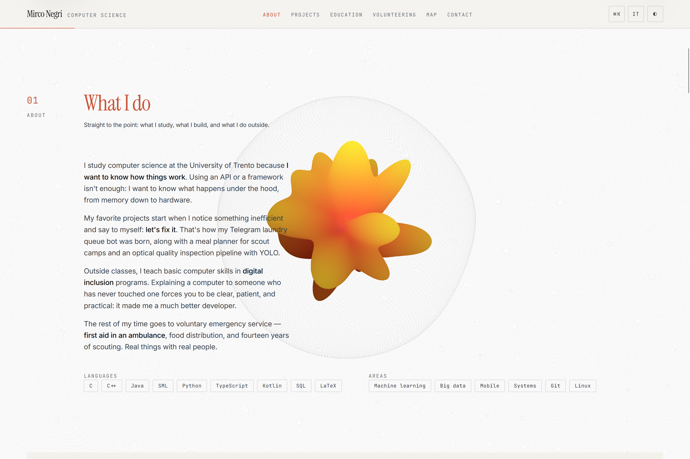 | 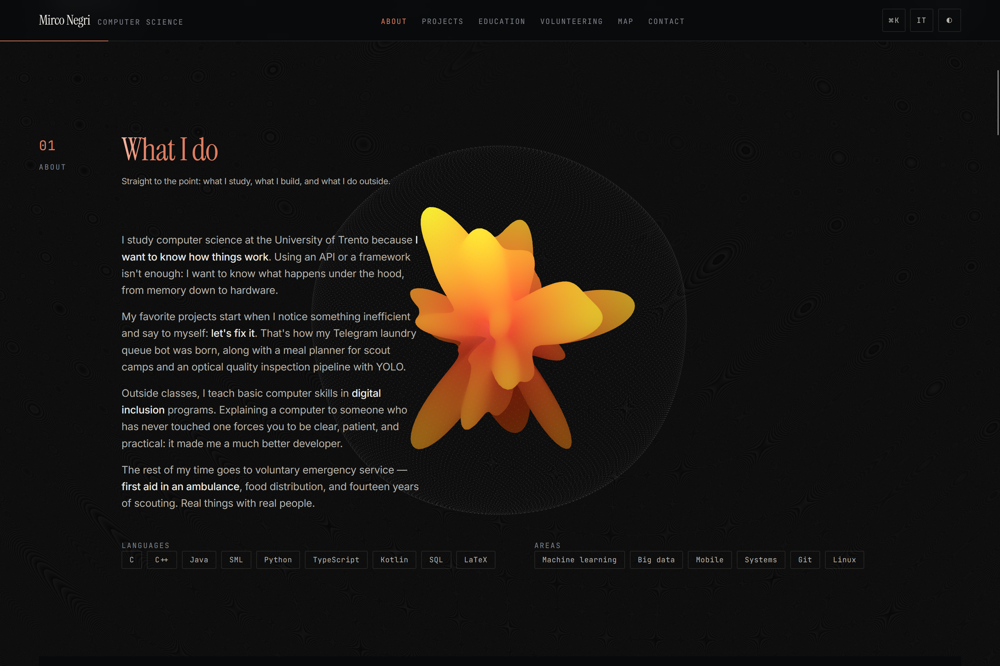 | 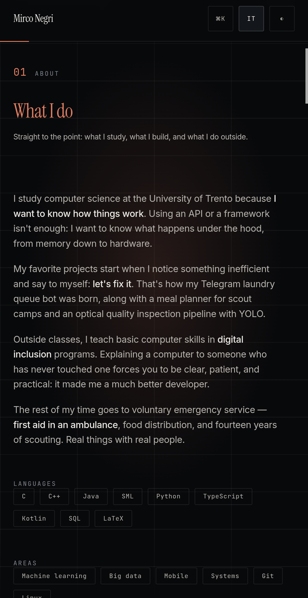 |
| **02. Projects**<br>*(Projects)* | 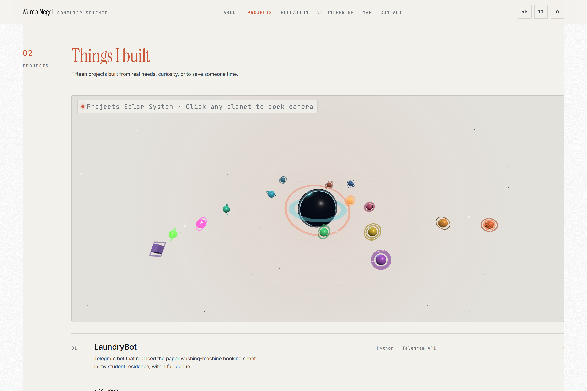 | 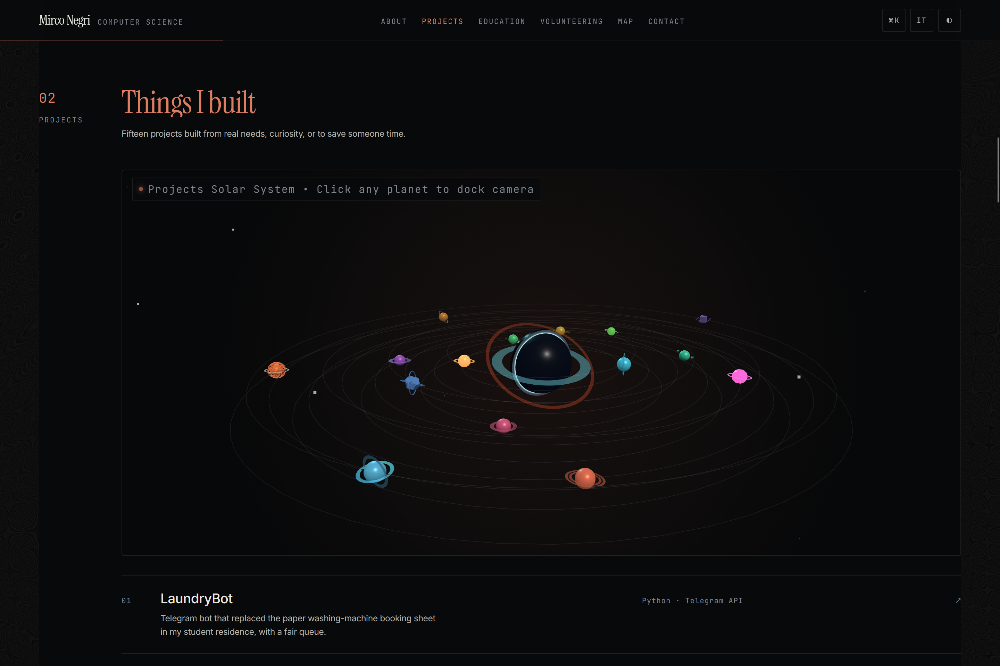 | 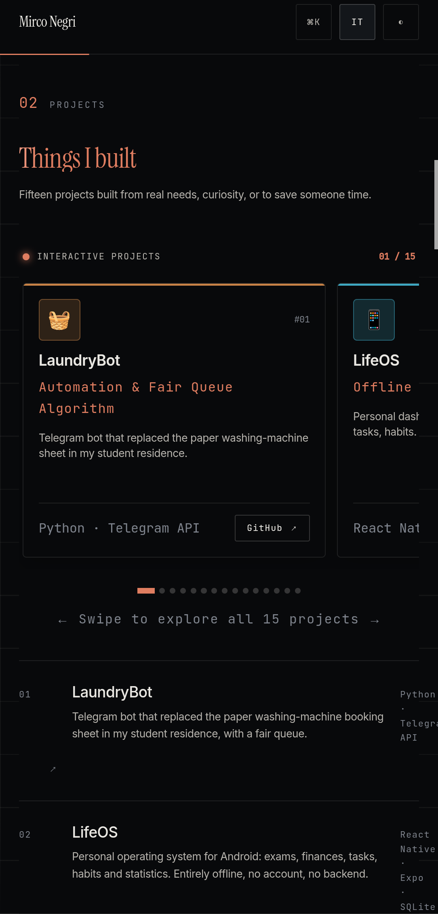 |
| **03. Education**<br>*(Education)* | 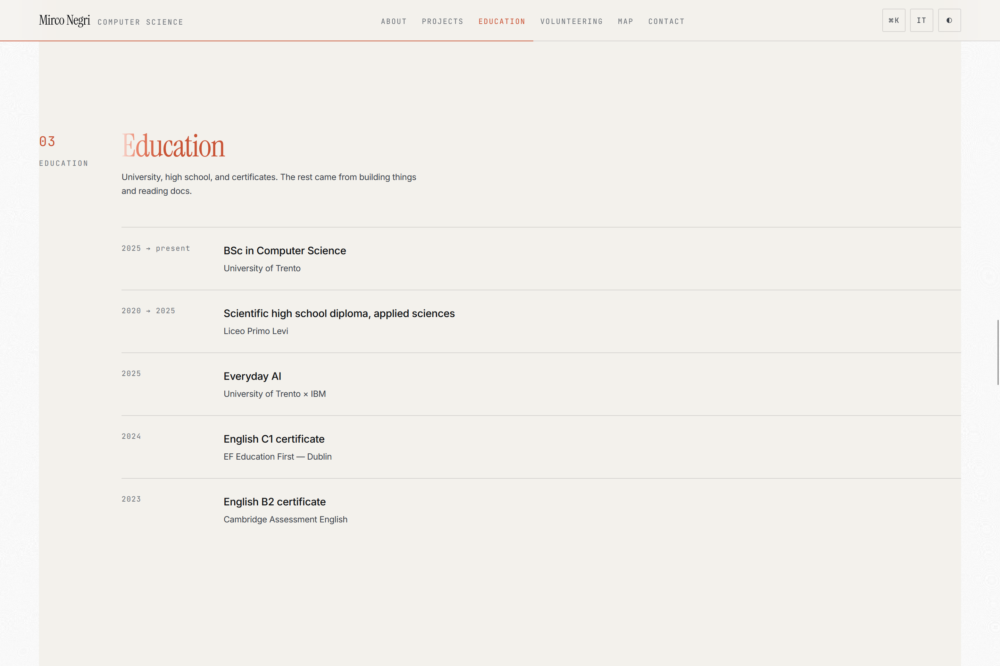 | 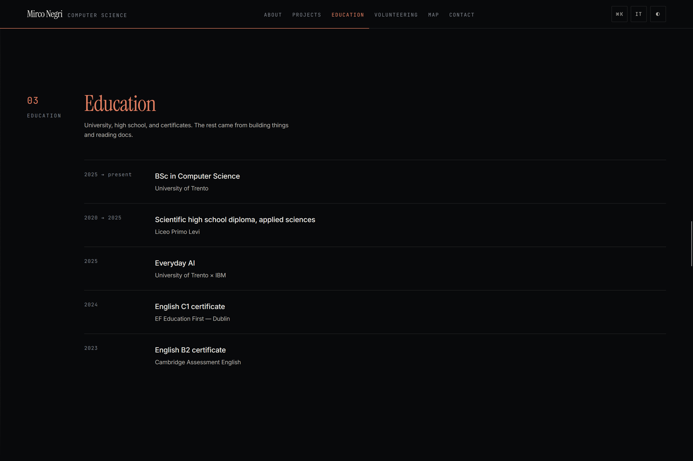 |  |
| **04. Volunteering**<br>*(Volunteering)* | 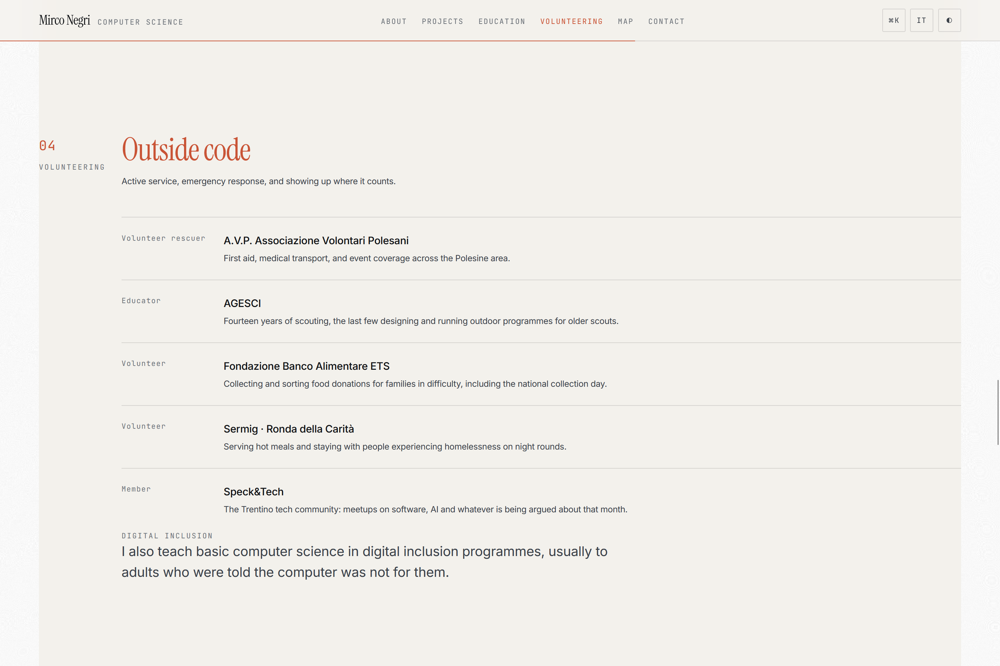 | 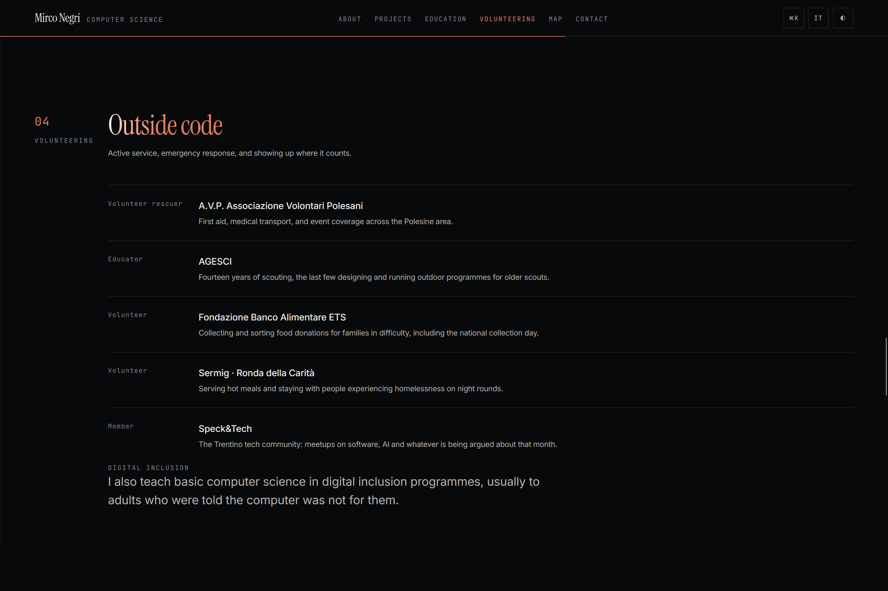 | 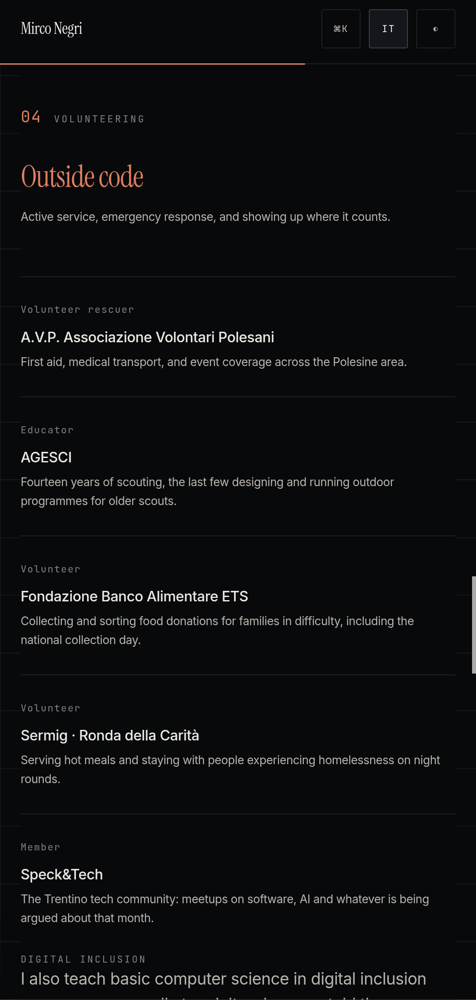 |
| **05. Map**<br>*(Map / Places)* | 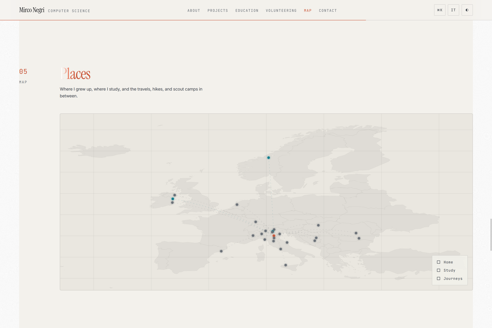 | 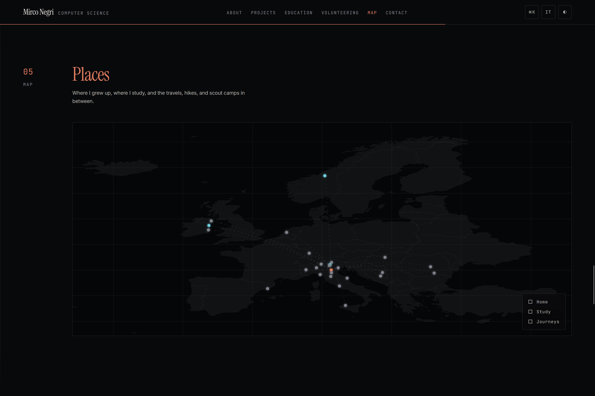 | 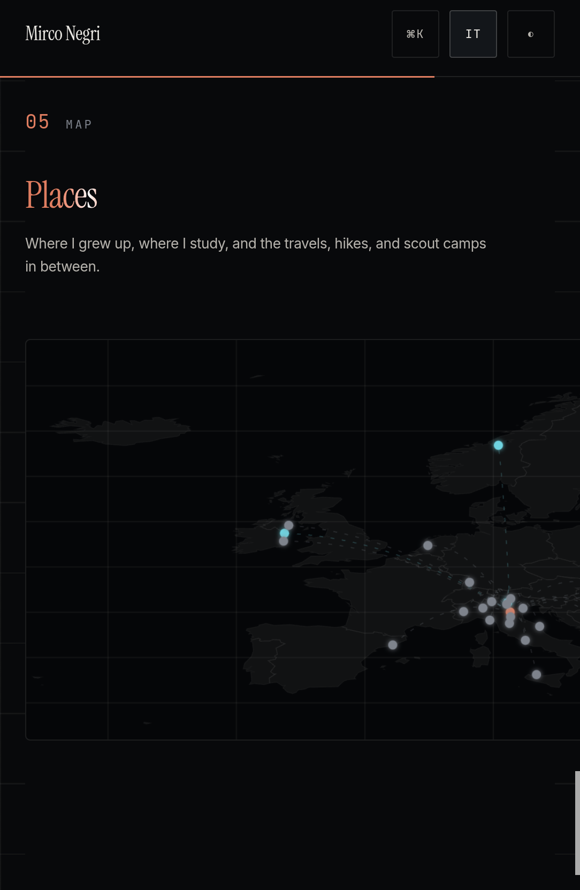 |
| **06. Contact**<br>*(Contact)* | 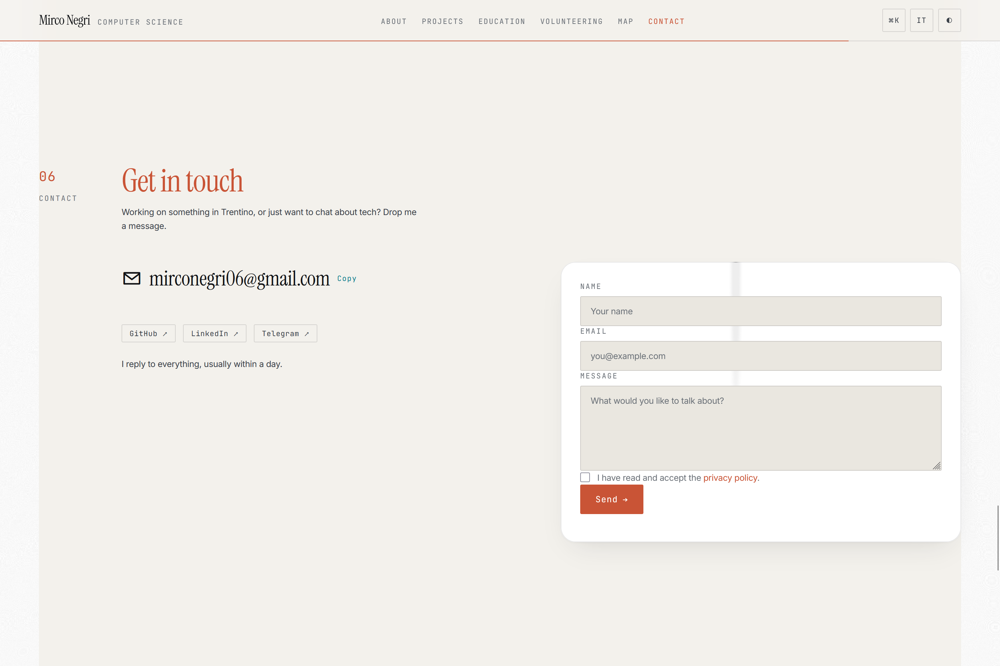 | 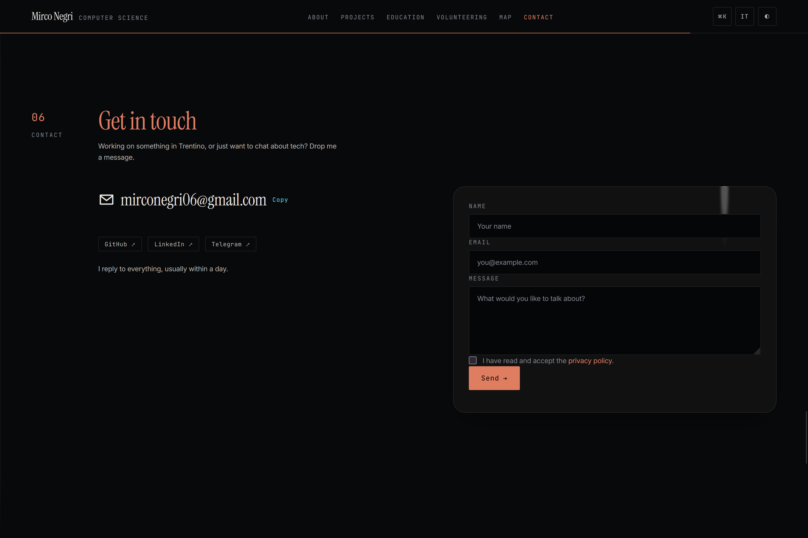 |  |

---

## Project Structure

```
mirconegri.com/
├── index.html               # Main semantic document with localization attributes
├── privacy.html             # Site privacy policy
├── package.json             # Project dependencies and build scripts
├── tsconfig.json            # Strict TypeScript configuration
├── vite.config.ts           # Vite build config emitting bundle into js/
├── biome.json               # Biome linter configuration
│
├── css/
│   ├── tokens.css           # Design tokens: palette, spacing, type scale, z-index
│   ├── base.css             # CSS reset, base typography, grid layout primitives
│   ├── components.css       # Navigation, icon buttons, command palette, cards, forms
│   ├── sections.css         # Sheet compositions (Hero, Strata, Works, etc.)
│   ├── motion.css           # Reveal animations and reduced-motion overrides
│   └── fonts.css            # Self-hosted @font-face declarations
│
├── src/
│   ├── main.tsx             # Application bootstrapper
│   ├── components/
│   │   ├── islands.tsx      # Mounts React components to data-island DOM targets
│   │   └── react-bits/      # SplitText, ProjectOrbit, CountUp, Magnet, SpotlightCard, DotGrid
│   └── lib/
│       ├── dom.ts           # Minimal typed DOM query and event helpers
│       ├── env.ts           # Math helpers (damp, lerp, clamp) and mobile device probe
│       ├── i18n.ts          # Localization manager (IT/EN)
│       ├── theme.ts         # Theme persistence and synchronization
│       ├── motion.ts        # GSAP ScrollTrigger and Lenis smooth scrolling
│       ├── strata.ts        # Custom WebGL2 noise sphere & 26k particle swarm
│       ├── terrain.ts       # Canvas 2D journey map renderer
│       ├── world-geo.ts     # Natural Earth 50m vector polygon coordinates
│       ├── palette.ts       # Fuzzy search and Command Palette logic
│       ├── contact.ts       # Contact form validation and async submission
│       └── sections.ts      # Scroll section rects and active sheet calculation
│
├── js/
│   ├── app.js               # Compiled client bundle (Vite)
│   └── react-bits.css       # Vendored styles for interactive islands
│
├── fonts/                   # Self-hosted WOFF2 fonts
│   ├── instrument-serif/
│   ├── inter/
│   └── jetbrains-mono/
│
└── assets/
    ├── CV_Mirco_Negri.pdf   # Downloadable curriculum vitae
    └── *.png                # Documentation and showcase preview screenshots
```

---

## Development & Tooling

### Prerequisites

- [Node.js](https://nodejs.org/) v20.19+ or v22+
- npm v10+

### Installation

```bash
git clone https://github.com/mirconegri/mirconegri.com.git
cd mirconegri.com
npm install
```

### Available Scripts

| Command | Action |
|---|---|
| `npm run dev` | Rebuilds `js/app.js` in watch mode as files change |
| `npm run serve` | Launches the Vite local preview server |
| `npm run build` | Compiles and optimizes production bundle into `js/` |
| `npm run typecheck` | Validates TypeScript types across `src/` (`tsc --noEmit`) |
| `npm run lint` | Runs [Biome](https://biomejs.dev/) static analysis |
| `npm test` | Runs unit tests with [Vitest](https://vitest.dev/) |

---

## Deployment

The site is continuously deployed via **Cloudflare Pages** connected directly to the `main` branch.

### Cloudflare Pages Configuration

- **Framework preset**: `None`
- **Build command**: `npm run build`
- **Build output directory**: `/` *(serves the repository root containing `index.html`)*
- **Environment variables**:
  - `NODE_VERSION`: `20`

---

## License

Open-sourced under the [MIT License](LICENSE).
© 2026 [Mirco Negri](https://mirconegri.com).
